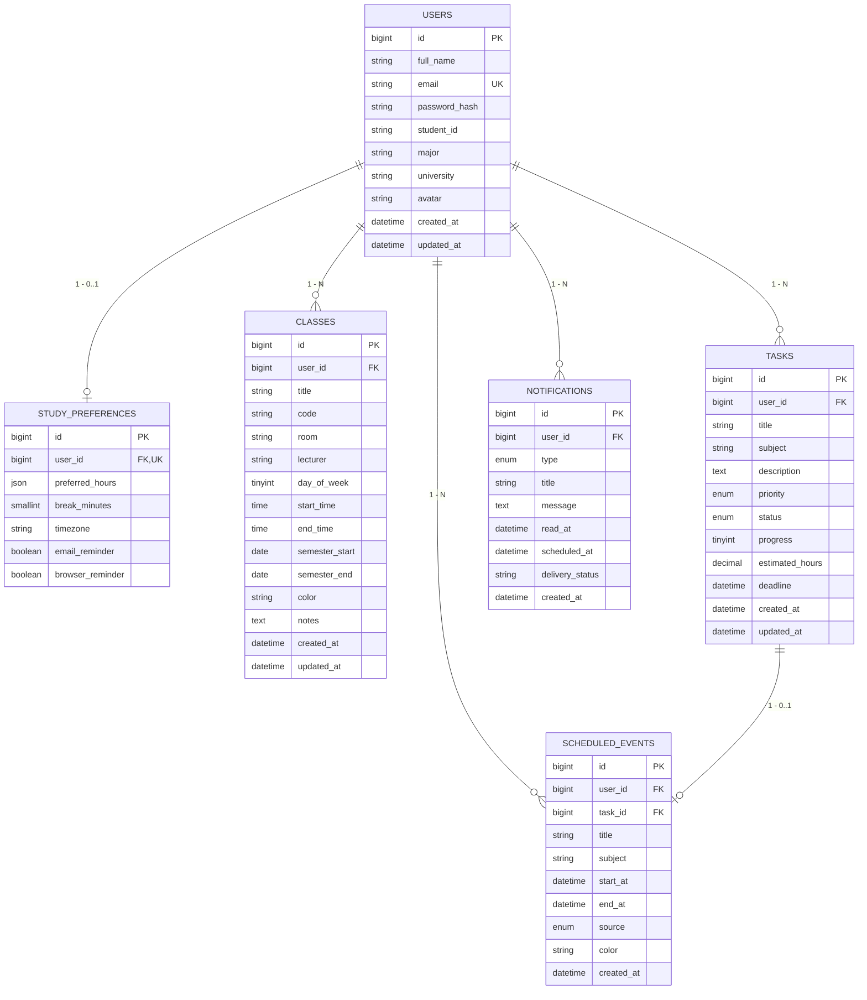

# PersonalPlanner — Thiết kế Cơ sở dữ liệu MySQL

> **Phạm vi:** Tài liệu này mô tả schema backend đang triển khai trong `backend/src/db/migrations/`. Hợp đồng API mục tiêu được mô tả tại [docs/shared-contract.md](./shared-contract.md); các sai khác giữa hợp đồng và migration cần được xử lý bằng thay đổi có chủ đích, không suy ra schema từ ERD khái niệm.
> **Tên Database:** `personalplanner`
> **Character Set:** `utf8mb4` | **Collation hiện tại:** `utf8mb4_0900_ai_ci`

---

## 1. Tổng quan kiến trúc dữ liệu

Cơ sở dữ liệu hiện có các bảng `users`, `study_preferences`, `classes`, `tasks`, `scheduled_events` và `notifications`. Các bảng tài nguyên có `user_id` đều tham chiếu `users(id)` với `ON DELETE CASCADE`; `scheduled_events` còn tham chiếu `tasks(id)` với `ON DELETE CASCADE`.
- **Bảo mật đa người dùng:** Dữ liệu của từng sinh viên được phân lập độc lập, bảo vệ qua JWT và ràng buộc khóa ngoại.
- **Tối ưu hóa truy vấn:** Các chỉ mục phục vụ lọc lớp theo ngày, task theo trạng thái/hạn chót, lịch theo khoảng thời gian và thông báo theo thời điểm tạo.

Migration hiện tại chưa tạo bảng `refresh_tokens`; MVP cũng chưa có refresh-token endpoint. File `backend/database/schema.sql` là script khởi tạo cũ, khác migration và có lệnh `DROP TABLE`. Không dùng file đó để cập nhật database đang có dữ liệu.

---

## 2. Sơ đồ thực thể quan hệ (ERD)



---

## 3. Chi tiết các bảng dữ liệu (Data Dictionary)

### 3.1. Bảng `users` (Tài khoản người dùng)
| Tên cột | Kiểu dữ liệu | Nullable | Mặc định | Ý nghĩa & Ràng buộc |
|---|---|---|---|---|
| `id` | `BIGINT UNSIGNED` | NO | `AUTO_INCREMENT` | Khóa chính |
| `full_name` | `VARCHAR(150)` | NO | | Họ và tên hiển thị |
| `email` | `VARCHAR(254)` | NO | | Email đăng nhập (Unique index `uq_users_email`) |
| `password_hash` | `VARCHAR(255)` | NO | | Mật khẩu băm an toàn bằng `bcrypt` |
| `student_id` | `VARCHAR(50)` | YES | `NULL` | Mã số sinh viên (giữ số 0 đầu) |
| `major` | `VARCHAR(500)` | YES | `NULL` | Ngành / Khoa |
| `university` | `VARCHAR(500)` | YES | `NULL` | Trường đại học |
| `avatar` | `VARCHAR(2048)` | YES | `NULL` | Đường dẫn ảnh đại diện |
| `created_at` | `DATETIME(3)` | NO | `CURRENT_TIMESTAMP(3)` | Thời điểm tạo |
| `updated_at` | `DATETIME(3)` | NO | `CURRENT_TIMESTAMP(3) ON UPDATE CURRENT_TIMESTAMP(3)` | Thời điểm cập nhật |

### 3.2. Bảng `study_preferences` (Khung giờ rảnh & Cài đặt AI)
| Tên cột | Kiểu dữ liệu | Nullable | Mặc định | Ý nghĩa & Ràng buộc |
|---|---|---|---|---|
| `id` | `BIGINT UNSIGNED` | NO | `AUTO_INCREMENT` | Khóa chính |
| `user_id` | `BIGINT UNSIGNED` | NO | | Khóa ngoại -> `users(id)`, Unique (1-1) |
| `preferred_hours` | `JSON` | NO | | Cấu hình `{morning, afternoon, evening}` theo hợp đồng `PreferredHours` |
| `break_minutes` | `SMALLINT UNSIGNED`| NO | `15` | Số phút nghỉ giữa các ca; migration chưa đặt CHECK constraint |
| `timezone` | `VARCHAR(100)` | NO | `'Asia/Ho_Chi_Minh'` | Múi giờ chuẩn IANA |
| `email_reminder` | `BOOLEAN` | NO | `TRUE` | Bật/tắt gửi mail định kỳ |
| `browser_reminder`| `BOOLEAN` | NO | `TRUE` | Bật/tắt thông báo trên web |

`user_id` có unique key `uq_study_preferences_user`, nên mỗi người dùng có tối đa một bản ghi tùy chọn. Bảng này hiện không có cột thời gian tạo/cập nhật.

### 3.3. Bảng `classes` (Thời khóa biểu học tập)
| Tên cột | Kiểu dữ liệu | Nullable | Mặc định | Ý nghĩa & Ràng buộc |
|---|---|---|---|---|
| `id` | `BIGINT UNSIGNED` | NO | `AUTO_INCREMENT` | Khóa chính |
| `user_id` | `BIGINT UNSIGNED` | NO | | Khóa ngoại -> `users(id)` |
| `title` | `VARCHAR(200)` | NO | | Tên môn học |
| `code` | `VARCHAR(500)` | YES | `NULL` | Mã môn học (vd: IT3020) |
| `room` | `VARCHAR(500)` | YES | `NULL` | Phòng học |
| `lecturer` | `VARCHAR(500)` | YES | `NULL` | Giảng viên phụ trách |
| `day_of_week` | `TINYINT UNSIGNED` | NO | | Thứ trong tuần: `0 = CN, 1 = T2, ..., 6 = T7` |
| `start_time` | `TIME` | NO | | Giờ bắt đầu (`CHECK start_time < end_time`) |
| `end_time` | `TIME` | NO | | Giờ kết thúc |
| `semester_start` | `DATE` | YES | `NULL` | Ngày bắt đầu học kỳ |
| `semester_end` | `DATE` | YES | `NULL` | Ngày kết thúc học kỳ |
| `color` | `CHAR(7)` | YES | `NULL` | Màu hex |
| `notes` | `TEXT` | YES | `NULL` | Ghi chú môn học |
| `created_at` | `DATETIME(3)` | NO | `CURRENT_TIMESTAMP(3)` | Thời điểm tạo |
| `updated_at` | `DATETIME(3)` | NO | `CURRENT_TIMESTAMP(3) ON UPDATE CURRENT_TIMESTAMP(3)` | Thời điểm cập nhật |

Chỉ mục `ix_classes_user_weekday` hỗ trợ lọc theo người dùng và thứ. Các CHECK constraint xác thực `day_of_week` từ 0 đến 6, giờ bắt đầu trước giờ kết thúc và ngày học kỳ không bị đảo.

### 3.4. Bảng `tasks` (Công việc & Kế hoạch)
| Tên cột | Kiểu dữ liệu | Nullable | Mặc định | Ý nghĩa & Ràng buộc |
|---|---|---|---|---|
| `id` | `BIGINT UNSIGNED` | NO | `AUTO_INCREMENT` | Khóa chính |
| `user_id` | `BIGINT UNSIGNED` | NO | | Khóa ngoại -> `users(id)` |
| `title` | `VARCHAR(200)` | NO | | Tên nhiệm vụ |
| `subject` | `VARCHAR(500)` | YES | `NULL` | Môn học liên quan |
| `description` | `TEXT` | YES | `NULL` | Mô tả chi tiết |
| `priority` | `ENUM` | NO | `'medium'` | `'urgent'`, `'high'`, `'medium'`, `'low'` |
| `status` | `ENUM` | NO | `'todo'` | `'todo'`, `'inprogress'`, `'done'` |
| `progress` | `TINYINT UNSIGNED` | NO | `0` | Tiến độ % (0 đến 100) |
| `estimated_hours`| `DECIMAL(7,2)` | YES | `NULL` | Thời lượng dự kiến (giờ), nếu có phải lớn hơn 0 |
| `deadline` | `DATETIME(3)` | YES | `NULL` | Hạn chót hoàn thành |
| `created_at` | `DATETIME(3)` | NO | `CURRENT_TIMESTAMP(3)` | Thời điểm tạo |
| `updated_at` | `DATETIME(3)` | NO | `CURRENT_TIMESTAMP(3) ON UPDATE CURRENT_TIMESTAMP(3)` | Thời điểm cập nhật |

Chỉ mục `ix_tasks_user_status_deadline` hỗ trợ lọc task theo người dùng, trạng thái và hạn chót. CHECK constraint giới hạn `progress` từ 0 đến 100 và yêu cầu task `done` có `progress = 100`.

### 3.5. Bảng `scheduled_events` (Lịch đã xác nhận áp dụng)
| Tên cột | Kiểu dữ liệu | Nullable | Mặc định | Ý nghĩa & Ràng buộc |
|---|---|---|---|---|
| `id` | `BIGINT UNSIGNED` | NO | `AUTO_INCREMENT` | Khóa chính |
| `user_id` | `BIGINT UNSIGNED` | NO | | Khóa ngoại -> `users(id)` |
| `task_id` | `BIGINT UNSIGNED` | NO | | Khóa ngoại -> `tasks(id)` |
| `title` | `VARCHAR(200)` | NO | | Tiêu đề hiển thị |
| `subject` | `VARCHAR(500)` | YES | `NULL` | Môn học |
| `start_at` | `DATETIME(3)` | NO | | Bắt đầu (`CHECK start_at < end_at`) |
| `end_at` | `DATETIME(3)` | NO | | Kết thúc |
| `source` | `ENUM` | NO | `'auto'` | `'auto'` (AI xếp) hoặc `'manual'` |
| `color` | `CHAR(7)` | YES | `NULL` | Màu hex hiển thị trên lịch |
| `created_at` | `DATETIME(3)` | NO | `CURRENT_TIMESTAMP(3)` | Thời điểm tạo |

`task_id` có unique key `uq_scheduled_events_task`, vì vậy mỗi task có tối đa một sự kiện đã áp dụng trong MVP. Chỉ mục `ix_scheduled_events_user_time` hỗ trợ truy vấn lịch theo người dùng và khoảng thời gian. Xóa task sẽ xóa sự kiện liên quan.

### 3.6. Bảng `notifications` (Thông báo)
| Tên cột | Kiểu dữ liệu | Nullable | Mặc định | Ý nghĩa & Ràng buộc |
|---|---|---|---|---|
| `id` | `BIGINT UNSIGNED` | NO | `AUTO_INCREMENT` | Khóa chính |
| `user_id` | `BIGINT UNSIGNED` | NO | | Khóa ngoại -> `users(id)` |
| `type` | `ENUM` | NO | `'info'` | `'urgent'`, `'info'`, `'success'` |
| `title` | `VARCHAR(200)` | NO | | Tiêu đề thông báo |
| `message` | `TEXT` | NO | | Nội dung chi tiết |
| `read_at` | `DATETIME(3)` | YES | `NULL` | Thời điểm đọc; trạng thái đọc được suy ra từ `read_at IS NOT NULL` |
| `scheduled_at` | `DATETIME(3)` | YES | `NULL` | Thời điểm dự kiến gửi |
| `delivery_status` | `VARCHAR(30)` | YES | `NULL` | Trạng thái gửi (chưa có ENUM/ràng buộc giá trị trong migration) |
| `created_at` | `DATETIME(3)` | NO | `CURRENT_TIMESTAMP(3)` | Thời điểm tạo |

Chỉ mục `ix_notifications_user_created` hỗ trợ lấy thông báo theo người dùng và thời điểm tạo. Migration hiện không có cột `is_read`; API `read` cần được ánh xạ từ `read_at`.

---

## 4. Hướng dẫn cài đặt CSDL

Tạo database theo hướng dẫn tại [backend/README.md](../backend/README.md), cấu hình `.env`, sau đó chạy migration:

```bash
npm.cmd --prefix backend run db:migrate
```

`backend/database/schema.sql` là script khởi tạo cũ, chưa đồng bộ với migration và chứa lệnh xóa bảng; không dùng script này để cập nhật database đang có dữ liệu. `backend/database/seed.sql` dùng các cột theo migration hiện tại, tạo tài khoản demo `demo@personalplanner.local` (mật khẩu `12345678`) cùng lớp học, công việc, lịch và thông báo mẫu. Có thể chạy lại seed mà không thêm trùng dữ liệu mẫu.

Sau khi chạy migration và cấu hình MySQL client, nạp dữ liệu demo bằng:

```powershell
Get-Content -Raw backend/database/seed.sql | mysql --default-character-set=utf8mb4 -u your_mysql_user -p personalplanner
```
