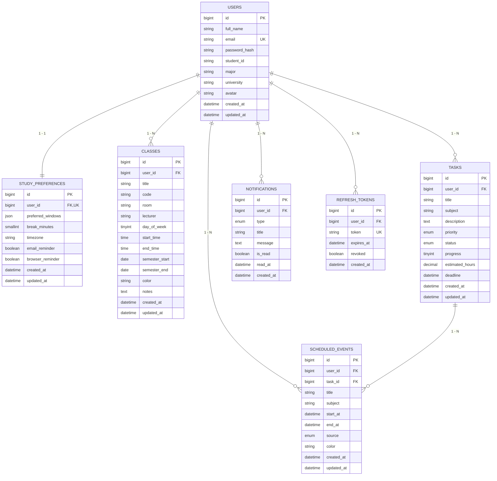

# PersonalPlanner — Thiết kế Cơ sở dữ liệu MySQL

> **Tài liệu tham chiếu chuẩn:** [docs/shared-contract.md](./shared-contract.md) và [docs/diagrams.md](./diagrams.md).  
> **Tên Database:** `personalplanner`  
> **Character Set:** `utf8mb4` | **Collation:** `utf8mb4_unicode_ci`

---

## 1. Tổng quan kiến trúc dữ liệu

Cơ sở dữ liệu được thiết kế theo chuẩn dạng chuẩn 3NF (Third Normal Form) nhằm đảm bảo:
- **Toàn vẹn tham chiếu:** Mọi bảng tài nguyên (`classes`, `tasks`, `scheduled_events`, `notifications`, `study_preferences`, `refresh_tokens`) đều gắn liền với `user_id` và có ràng buộc `ON DELETE CASCADE`.
- **Bảo mật đa người dùng:** Dữ liệu của từng sinh viên được phân lập độc lập, bảo vệ qua JWT và ràng buộc khóa ngoại.
- **Tối ưu hóa truy vấn:** Tạo các chỉ mục phức hợp (`Composite Indexes`) phục vụ nhanh việc lọc trạng thái, ngày trong tuần, và quét khoảng thời gian trống cho thuật toán lập lịch.

---

## 2. Sơ đồ thực thể quan hệ (ERD)



---

## 3. Chi tiết các bảng dữ liệu (Data Dictionary)

### 3.1. Bảng `users` (Tài khoản người dùng)
| Tên cột | Kiểu dữ liệu | Nullable | Mặc định | Ý nghĩa & Ràng buộc |
|---|---|---|---|---|
| `id` | `BIGINT UNSIGNED` | NO | `AUTO_INCREMENT` | Khóa chính |
| `full_name` | `VARCHAR(150)` | NO | | Họ và tên hiển thị |
| `email` | `VARCHAR(255)` | NO | | Email đăng nhập (Unique index `uq_users_email`) |
| `password_hash` | `VARCHAR(255)` | NO | | Mật khẩu băm an toàn bằng `bcrypt` |
| `student_id` | `VARCHAR(50)` | YES | `NULL` | Mã số sinh viên (giữ số 0 đầu) |
| `major` | `VARCHAR(150)` | YES | `NULL` | Ngành / Khoa |
| `university` | `VARCHAR(200)` | YES | `NULL` | Trường đại học |
| `avatar` | `VARCHAR(2048)` | YES | `NULL` | Đường dẫn ảnh đại diện |
| `created_at` | `DATETIME` | NO | `CURRENT_TIMESTAMP` | Thời điểm tạo |
| `updated_at` | `DATETIME` | NO | `CURRENT_TIMESTAMP ON UPDATE` | Thời điểm cập nhật |

### 3.2. Bảng `study_preferences` (Khung giờ rảnh & Cài đặt AI)
| Tên cột | Kiểu dữ liệu | Nullable | Mặc định | Ý nghĩa & Ràng buộc |
|---|---|---|---|---|
| `id` | `BIGINT UNSIGNED` | NO | `AUTO_INCREMENT` | Khóa chính |
| `user_id` | `BIGINT UNSIGNED` | NO | | Khóa ngoại -> `users(id)`, Unique (1-1) |
| `preferred_windows` | `JSON` | NO | | Cấu hình `{morning, afternoon, evening}` |
| `break_minutes` | `SMALLINT UNSIGNED`| NO | `15` | Số phút nghỉ giải lao giữa các ca (0 - 180 phút) |
| `timezone` | `VARCHAR(100)` | NO | `'Asia/Ho_Chi_Minh'` | Múi giờ chuẩn IANA |
| `email_reminder` | `BOOLEAN` | NO | `TRUE` | Bật/tắt gửi mail định kỳ |
| `browser_reminder`| `BOOLEAN` | NO | `TRUE` | Bật/tắt thông báo trên web |

### 3.3. Bảng `classes` (Thời khóa biểu học tập)
| Tên cột | Kiểu dữ liệu | Nullable | Mặc định | Ý nghĩa & Ràng buộc |
|---|---|---|---|---|
| `id` | `BIGINT UNSIGNED` | NO | `AUTO_INCREMENT` | Khóa chính |
| `user_id` | `BIGINT UNSIGNED` | NO | | Khóa ngoại -> `users(id)` |
| `title` | `VARCHAR(200)` | NO | | Tên môn học |
| `code` | `VARCHAR(50)` | YES | `NULL` | Mã môn học (vd: IT3020) |
| `room` | `VARCHAR(100)` | YES | `NULL` | Phòng học |
| `lecturer` | `VARCHAR(150)` | YES | `NULL` | Giảng viên phụ trách |
| `day_of_week` | `TINYINT UNSIGNED` | NO | | Thứ trong tuần: `0 = CN, 1 = T2, ..., 6 = T7` |
| `start_time` | `TIME` | NO | | Giờ bắt đầu (`CHECK start_time < end_time`) |
| `end_time` | `TIME` | NO | | Giờ kết thúc |
| `semester_start` | `DATE` | YES | `NULL` | Ngày bắt đầu học kỳ |
| `semester_end` | `DATE` | YES | `NULL` | Ngày kết thúc học kỳ |
| `color` | `VARCHAR(20)` | YES | `'#4f46e5'` | Màu nhận diện trên FullCalendar |
| `notes` | `TEXT` | YES | `NULL` | Ghi chú môn học |

### 3.4. Bảng `tasks` (Công việc & Kế hoạch)
| Tên cột | Kiểu dữ liệu | Nullable | Mặc định | Ý nghĩa & Ràng buộc |
|---|---|---|---|---|
| `id` | `BIGINT UNSIGNED` | NO | `AUTO_INCREMENT` | Khóa chính |
| `user_id` | `BIGINT UNSIGNED` | NO | | Khóa ngoại -> `users(id)` |
| `title` | `VARCHAR(200)` | NO | | Tên nhiệm vụ |
| `subject` | `VARCHAR(150)` | YES | `NULL` | Môn học liên quan |
| `description` | `TEXT` | YES | `NULL` | Mô tả chi tiết |
| `priority` | `ENUM` | NO | `'medium'` | `'urgent'`, `'high'`, `'medium'`, `'low'` |
| `status` | `ENUM` | NO | `'todo'` | `'todo'`, `'inprogress'`, `'done'` |
| `progress` | `TINYINT UNSIGNED` | NO | `0` | Tiến độ % (0 đến 100) |
| `estimated_hours`| `DECIMAL(5,2)` | YES | `1.50` | Thời lượng dự kiến (giờ) |
| `deadline` | `DATETIME` | YES | `NULL` | Hạn chót hoàn thành |

### 3.5. Bảng `scheduled_events` (Lịch đã xác nhận áp dụng)
| Tên cột | Kiểu dữ liệu | Nullable | Mặc định | Ý nghĩa & Ràng buộc |
|---|---|---|---|---|
| `id` | `BIGINT UNSIGNED` | NO | `AUTO_INCREMENT` | Khóa chính |
| `user_id` | `BIGINT UNSIGNED` | NO | | Khóa ngoại -> `users(id)` |
| `task_id` | `BIGINT UNSIGNED` | NO | | Khóa ngoại -> `tasks(id)` |
| `title` | `VARCHAR(200)` | NO | | Tiêu đề hiển thị |
| `subject` | `VARCHAR(150)` | YES | `NULL` | Môn học |
| `start_at` | `DATETIME` | NO | | Bắt đầu (`CHECK start_at < end_at`) |
| `end_at` | `DATETIME` | NO | | Kết thúc |
| `source` | `ENUM` | NO | `'auto'` | `'auto'` (AI xếp) hoặc `'manual'` |
| `color` | `VARCHAR(20)` | YES | `'#8b5cf6'` | Màu hiển thị trên lịch |

### 3.6. Bảng `notifications` (Thông báo)
| Tên cột | Kiểu dữ liệu | Nullable | Mặc định | Ý nghĩa & Ràng buộc |
|---|---|---|---|---|
| `id` | `BIGINT UNSIGNED` | NO | `AUTO_INCREMENT` | Khóa chính |
| `user_id` | `BIGINT UNSIGNED` | NO | | Khóa ngoại -> `users(id)` |
| `type` | `ENUM` | NO | `'info'` | `'urgent'`, `'info'`, `'success'` |
| `title` | `VARCHAR(255)` | NO | | Tiêu đề thông báo |
| `message` | `TEXT` | NO | | Nội dung chi tiết |
| `is_read` | `BOOLEAN` | NO | `FALSE` | Trạng thái đã đọc |
| `read_at` | `DATETIME` | YES | `NULL` | Thời điểm đọc |

### 3.7. Bảng `refresh_tokens` (Quản lý phiên JWT)
| Tên cột | Kiểu dữ liệu | Nullable | Mặc định | Ý nghĩa & Ràng buộc |
|---|---|---|---|---|
| `id` | `BIGINT UNSIGNED` | NO | `AUTO_INCREMENT` | Khóa chính |
| `user_id` | `BIGINT UNSIGNED` | NO | | Khóa ngoại -> `users(id)` |
| `token` | `VARCHAR(255)` | NO | | Chuỗi refresh token (Unique) |
| `expires_at` | `DATETIME` | NO | | Thời điểm hết hạn |
| `revoked` | `BOOLEAN` | NO | `FALSE` | Trạng thái thu hồi (khi đăng xuất) |

---

## 4. Hướng dẫn cài đặt CSDL

### Cách 1: Sử dụng MySQL Workbench
1. Mở MySQL Workbench, kết nối tới máy chủ MySQL cục bộ (Local instance 3306).
2. Vào **File** -> **Open SQL Script...** -> Chọn file [backend/database/schema.sql](../backend/database/schema.sql).
3. Bấm biểu tượng tia sét **Execute** để tạo Database và các Bảng.
4. Mở tiếp file [backend/database/seed.sql](../backend/database/seed.sql) và bấm **Execute** để nạp dữ liệu mẫu ban đầu.

### Cách 2: Sử dụng dòng lệnh Terminal
```bash
mysql -u root -p < backend/database/schema.sql
mysql -u root -p personalplanner < backend/database/seed.sql
```

