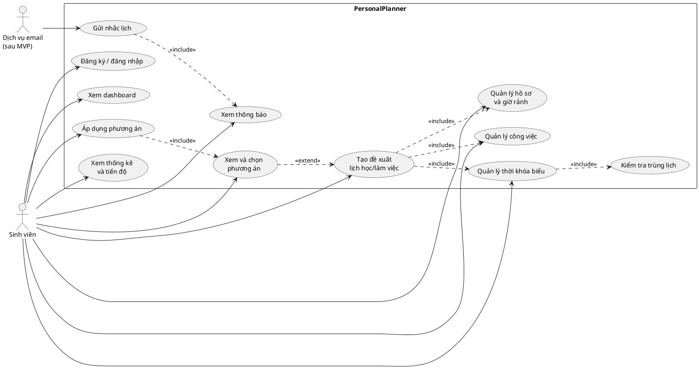
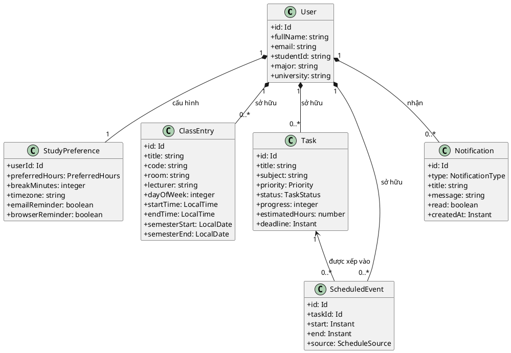
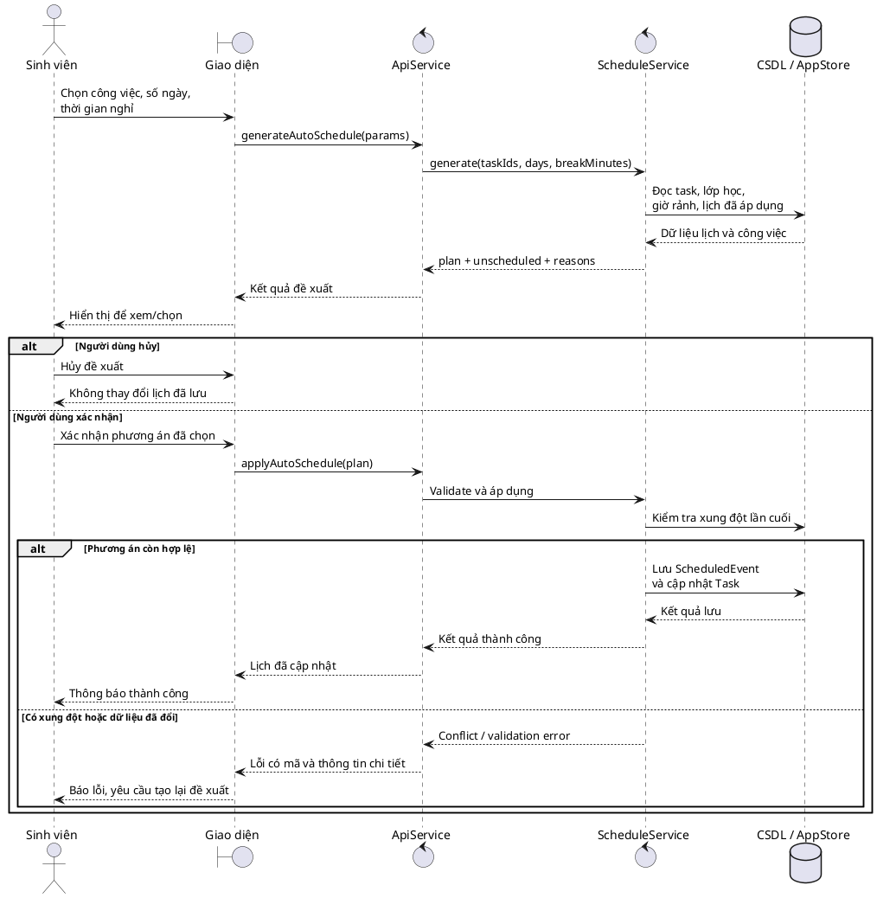
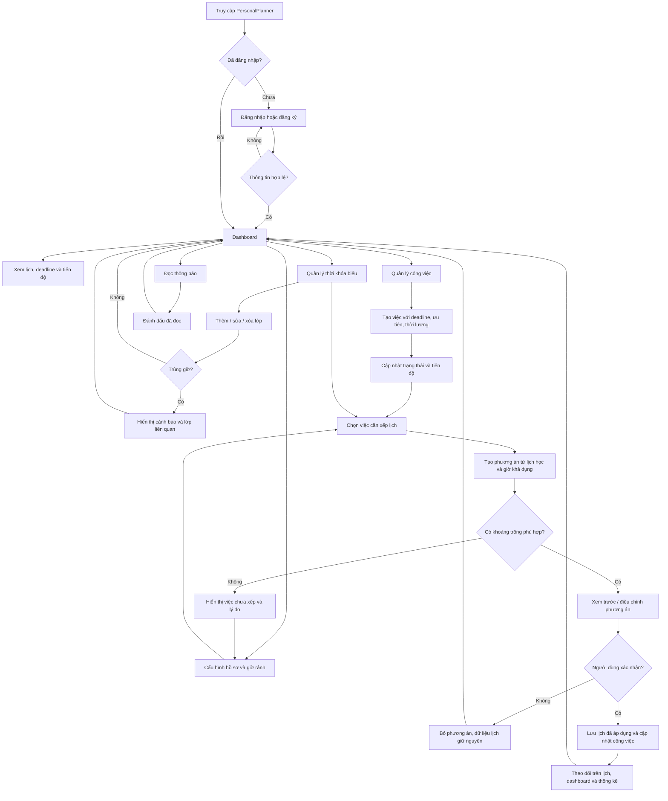
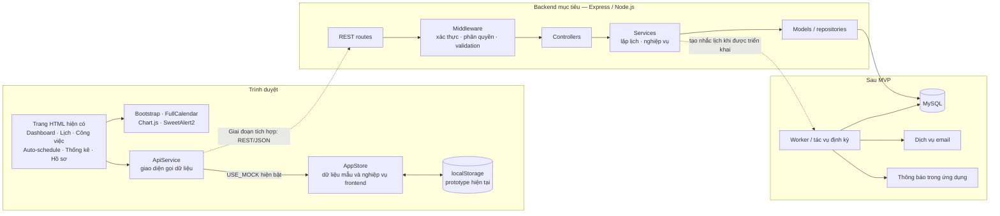

# PersonalPlanner — Sơ đồ sản phẩm và hệ thống

Các sơ đồ dưới đây phân biệt **frontend prototype hiện có** với **kiến trúc mục tiêu**. ERD là mô hình khái niệm, cần chốt trường và ràng buộc trước khi tạo migration.

> Quy ước field, enum, ngày giờ, API và quy tắc nghiệp vụ dùng chung được quản lý tập trung tại [shared-contract.md](./shared-contract.md). Khi sơ đồ và code không khớp, xem mục trạng thái triển khai trong hợp đồng trước khi thay đổi.

## 0. UML Use Case

Sơ đồ thể hiện phạm vi sản phẩm mục tiêu; đăng nhập thật, email và backend chưa có trong prototype.



## 0.1 UML Class Diagram — mô hình miền nghiệp vụ

Các lớp dưới đây mô tả mô hình mục tiêu và quan hệ dữ liệu, không khẳng định backend đã được tạo. Field chuẩn và kiểu dữ liệu được định nghĩa tại [shared-contract.md](./shared-contract.md).



## 0.2 UML Sequence Diagram — đề xuất và áp dụng lịch

Đề xuất chỉ đọc dữ liệu để tính toán; chỉ thao tác áp dụng mới ghi lịch và cập nhật trạng thái liên quan.



## 1. Luồng người dùng chính



### Quy tắc cho luồng

- Tạo đề xuất không đồng nghĩa với áp dụng; dữ liệu lịch chỉ đổi sau xác nhận.
- Không có slot khả dụng là kết quả nghiệp vụ bình thường, cần nêu nguyên nhân và gợi ý hành động.
- Frontend hiện có các màn hình và một số hành vi demo; trạng thái xác thực thật, nhắc email và API cần backend.

## 2. Kiến trúc hiện tại và đích đến



### Trạng thái kiến trúc

- **Đang có ở frontend:** các trang tĩnh, `AppStore`, localStorage và `ApiService` với mock bật.
- **Đã có code backend ban đầu:** Express routes/services, middleware JWT, schema và migration MySQL. Cần cấu hình MySQL để chạy đầy đủ; chưa có bằng chứng triển khai production.
- **Chưa triển khai:** worker/cron, gửi email và refresh-token/session revocation.
- **Nguyên tắc chuyển đổi:** giữ `ApiService` làm ranh giới dữ liệu; thống nhất response/error contract trước khi chuyển khỏi mock.
- Khi tích hợp, server phải kiểm tra quyền sở hữu từng bản ghi; token và secrets không được xem là an toàn chỉ vì được lưu phía client.

## 3. ERD khái niệm

```mermaid
erDiagram
    USER ||--|| STUDY_PREFERENCE : configures
    USER ||--o{ CLASS : owns
    USER ||--o{ TASK : owns
    USER ||--o{ SCHEDULED_EVENT : owns
    USER ||--o{ NOTIFICATION : receives
    TASK ||--o{ SCHEDULED_EVENT : can_be_planned_as

    USER {
        bigint id PK
        string full_name
        string email UK
        string password_hash
        string student_id
        string major
        string university
        datetime created_at
        datetime updated_at
    }

    STUDY_PREFERENCE {
        bigint id PK
        bigint user_id FK
        json preferred_windows
        int break_minutes
        string timezone
        boolean email_reminder
        boolean browser_reminder
    }

    CLASS {
        bigint id PK
        bigint user_id FK
        string title
        string code
        string room
        string lecturer
        int day_of_week
        time start_time
        time end_time
        date semester_start
        date semester_end
        string notes
        string color
    }

    TASK {
        bigint id PK
        bigint user_id FK
        string title
        string subject
        text description
        string priority
        string status
        int progress
        decimal estimated_hours
        datetime deadline
        datetime created_at
        datetime updated_at
    }

    SCHEDULED_EVENT {
        bigint id PK
        bigint user_id FK
        bigint task_id FK
        datetime start_at
        datetime end_at
        string status
        string source
        datetime created_at
    }

    NOTIFICATION {
        bigint id PK
        bigint user_id FK
        string type
        string title
        text message
        datetime scheduled_at
        datetime read_at
        string delivery_status
    }
```

### Ghi chú thiết kế dữ liệu

- `CLASS` là buổi học lặp theo thứ trong tuần trong một khoảng học kỳ; cần xác nhận quy tắc tuần nghỉ/ngoại lệ trước khi thiết kế đầy đủ.
- `STUDY_PREFERENCE.preferred_windows` có thể được chuẩn hóa thành bảng khung giờ nếu cần truy vấn/phân tích riêng; sơ đồ giữ JSON để thể hiện cấu hình MVP hiện tại mà không khóa cách triển khai.
- `SCHEDULED_EVENT` chỉ biểu diễn lịch đã được áp dụng. Phương án xem trước nên là dữ liệu tạm hoặc một thực thể proposal riêng nếu cần lưu lịch sử/duyệt nhiều lần.
- Cần ràng buộc quyền sở hữu qua `user_id`, kiểm tra `start_at < end_at`, trạng thái/priority hợp lệ và chống xung đột ở tầng nghiệp vụ.
- Không lưu mật khẩu rõ; `password_hash` chỉ lưu giá trị đã băm ở backend. Refresh token/session, nếu triển khai, cần mô hình và chính sách thu hồi riêng.
